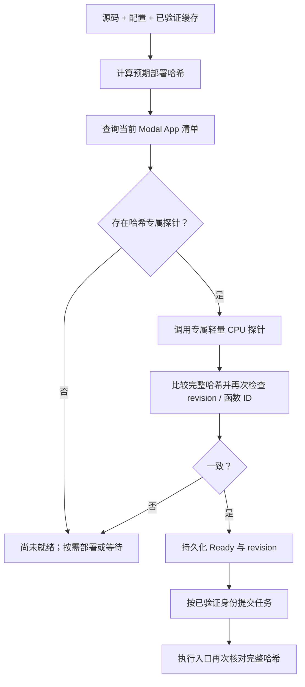
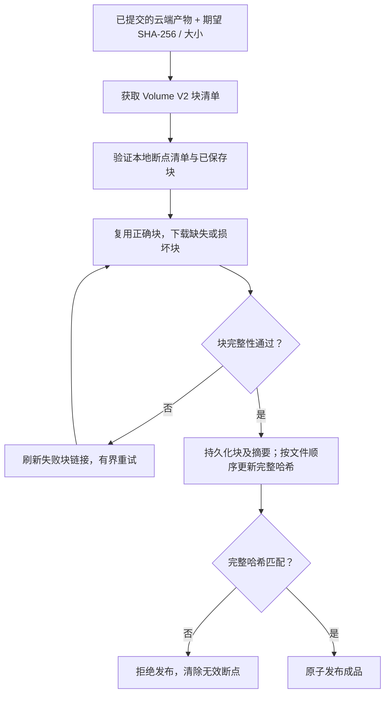

# 运行时可靠性设计：版本专属探针与可恢复传输

日期：2026-11-25。状态：已实现，PC2 回归及 CNB 线上非 GPU 验收通过。
适用提交：[b849892](https://github.com/xiaoqianran/modal-vllm-sglang/commit/b849892)、[2914e36](https://github.com/xiaoqianran/modal-vllm-sglang/commit/2914e36)。

## 1. 核心设计原则

**不要等待旧版本消失，而要直接验证新版本存在。** 控制面的就绪检查与 GPU 数据面的推理分离；
任务执行与产物传输分离；任何恢复操作都应复用已有的可信结果，而不是重放昂贵的计算。
版本号、缓存指纹、调用回执和内容摘要分别描述不同身份，不能互相替代。

## 2. 滚动部署：内容寻址探针

### 故障机制与触发条件

滚动部署允许旧容器暂时存活。此前所有版本共用 `provision_info`，
每隔约 3 秒重新查询一次，可能持续访问旧容器。2026-11-25 的 MiniMax 故障中，
v3 已发布但探针仍返回 v2 的哈希；优雅停止旧探针容器后才恢复。
该现象可在源码、配置或模型缓存变化触发滚动部署，以及旧探针尚未退出时出现。
反复查询延长旧容器存活是合理的机制解释，不代表已证明每次旧容器滞留都由此造成。
历史记录中返回 `manual` 的另一次失败，不应简单归为同一根因。

另一个独立缺陷是 Windows Git checkout 使用 CRLF、Linux 使用 LF，
旧算法对原始文件字节哈希会让相同 Git 提交产生不同源码指纹。
因此对 Python/JSON 统一 CRLF 为 LF，按 POSIX 相对路径排序后计算指纹，
不忽略其他内容变化。Git HEAD 相同不等于工作区相同，更不等于模型缓存相同。

### 最终方案



- 每个托管部署注册 `provision_info_<hash前32位>`，避免调用旧版本同名探针。返回并比较的是完整 64 位十六进制哈希，不仅仅是名称中的前缀。固定名称仅作手动/旧版诊断，不能作为托管版本通过的证据。
- 先读取当前 App 清单；没有目标 tag 时不启动 CPU 容器。调用前后核对当前 App revision 和 tag 对应的函数 ID，防止滚动发布或回滚竞态。
- 探针使用 `single_use_containers=True`、`scaledown_window=2`、CPU 0.25 核、512 MiB 内存、执行超时 15 秒、启动超时 30 秒、平台重试 0；本地调用等待上限 35 秒，超时取消该探针调用，不强制关闭 GPU 容器。
- CNB 的 chutianqiuer 工作区未配置历史 revision 保留，实测 `Function.from_name(..., version=revision)` 被 Modal 拒绝。因此最终方案仅查询当前 App 的专属函数，不要求付费套餐或历史版本调用。
- CPU 编排使用 `run_shot_<hash前32位>` 专属入口；GPU 保留稳定 Class 名，句柄按部署哈希隔离，新托管请求携带完整预期哈希，执行入口在生成前拒绝不匹配版本。旧容器若收到新请求，可能拒绝请求而不是执行错误版本；这不是保证所有旧 GPU 容器自动消失的机制。
- 继续使用 rolling；共享 admission/lease 保护在途任务，已接受调用按原 call ID 查询。禁止因校验不确定而盲目重部署、重放生成或强制重建 App。显式诊断与实际 GPU 验收仍是不同阶段。

### 实测结果

| 服务 | 最终 Modal revision | 部署校验耗时 | 结果 |
| --- | --- | ---: | --- |
| MOSS | 5 | 4.73 s | Ready |
| MiniMax | 5 | 6.59 s | Ready |
| Orchestration | 2 | 5.23 s | Ready |

历史 MiniMax 校验 162.26 s（含人工停止旧探针的等待），最终 6.59 s，
单次观测下降约 95.9%，不是同条件多轮 benchmark，也不是模型加载或整次部署速度。
最终 MiniMax 构建部署阶段另耗时约 16.21 s。三个 App 的期望/实际哈希完全相同，
单次探针配置线上确认，结束后容器列表为空；没有人工停止旧容器或重新下载权重。
PC2 与 CNB 的四模型和编排共五个源码指纹逐项一致。

## 3. 大文件：分块验证、恢复与单遍完整哈希

HF 模型下载沿用 `verification_mode="xet"`（参见 `tools/download_models.py`）；
生成结果从 Modal Volume V2 下载不是 HF Xet，使用 Volume 原生分块传输和数据块摘要。



大文件至少 8 MiB 且提供期望大小和 SHA-256 时启用 V2 分块恢复。
当前每块 8 MiB，最多 3 块并行，每次总超时 60 秒、读空闲超时 20 秒、
最多 3 次尝试；失败块单独刷新下载链接。分组等待确保已成功兄弟块不会因另一块失败丢失，
但组内仍有慢块等待，不能宣称彻底消除网络停顿。

临时文件 `<name>.volume-part` 与 `<name>.volume-part.json` 保存恢复状态。
恢复身份包含 Volume ID、路径、期望 SHA-256、长度和块布局；已保存块重新验证后才复用。
首次下载直接对内存中的有序数据计算完整 SHA-256，避免完成后再读取整个文件。
续传时重新读取已保留块重建哈希，新的块直接计算；不信任序列化哈希状态或未校验的稀疏文件。
完整摘要和媒体头检查通过才原子替换成品。小文件、V1 或不支持该适配器的后端使用普通流式下载。

### 真实文件恢复验收

使用上一轮 MiniMax 的 `006_image.png`（5472 × 3072，50,436,942 字节）。
在真实 HTTP 块获取过程中注入一次暂时超时，再注入块 1 中断；首次保留块 0、2，
续传复用 16,777,216 字节（16 MiB），只传输余下 33,659,726 字节。
恢复阶段约 70.27 s，仍受网络影响；不是吞吐性能基准。
最终文件大小、完整 SHA-256 和 PIL PNG 校验通过，无重复 GPU 生成。
独立的最终验收读取文件进行比对，不代表生产下载路径会二次全量读取。

## 4. 验证与维护边界

PC2 最终回归 316 项测试、206 项子测试通过，CNB 14 项专项测试通过；
CNB 已完成真实探针部署及大文件断点恢复，但未重新运行 24 张图片的 GPU 推理，
未验证跨批次 Snapshot 恢复。不要将 CPU Ready 等同于 GPU 已就绪。
Volume V2 分块适配依赖 Modal SDK 1.6.4 的内部 RPC/块摘要契约，
SDK 升级必须重新测试真实传输、超时、损坏块、断点恢复以及 V1/公共流式回退路径。

| 关键实现 | 职责 |
| --- | --- |
| [deployment_probe.py](../runtime/serving/deployment_probe.py) | 专属名称、探针配置、完整版本断言 |
| [provisioning.py](../orchestration/provisioning.py) | 当前 App 清单校验、就绪状态、恢复与排空 |
| [deployment_state.py](../orchestration/deployment_state.py) | 跨平台源码身份 |
| [sdk.py](../orchestration/sdk.py) | GPU 句柄隔离与预期版本传递 |
| [deploy_shot.py](../pipeline/deploy_shot.py) | CPU 工作流版本入口 |
| [model_runtime.py](../runtime/serving/model_runtime.py) | GPU 执行前的版本保护 |
| [volume_download.py](../runtime/utils/volume_download.py) | 有界分块下载、恢复与原子发布 |
| [files.py](../runtime/utils/files.py) | 公共流式传输入口 |
| [专项测试](../tests/test_probe_volume_recovery.py) | 版本与断点恢复回归 |

复用这些设计时应优先消除错误的等待依赖、保留不可变身份与可验证证据，再考虑增加并发、延长超时或扩大资源。

## 5. SDK 会话复用与不可变首尾帧输入（2026-11-25）

- Runner 以进程内 SDKSession 管理有界 Call 句柄（256）、已验证输入及最近账本检查时间（各512）。模型句柄及缓存指纹按原身份复用，并发首次创建按键加锁；有完整部署哈希的工作流函数按专属 tag 复用，旧式未固定版本的函数仍逐次解析。部署版本保护、SubmissionLedger 原子保留和已提交任务不重放的原则不变。
- 已知在途 Call 的账本首查、每6秒复查，以及 Call 返回/异常后即时复查；无 call_id 或 uncertain 状态仍逐次读取权威账本。Call.get(timeout=0) 轮询频率不变。只缓存检查时间，不缓存可变执行状态。若结果在 Call 结束前写入，常规发现延迟可能增加至6秒加调度/网络耗时；Call 终止或异常不受该间隔限制。
- 首尾帧按原 SHA-256 路径 staging：先读取并校验本地快照，已存在对象验证大小及完整哈希，缺失才以 force=False 上传。并发冲突时仅接受 FileExistsError 或 SDK 1.6.4 针对精确目标路径的 InvalidError（真实返回 path "<key>" already exists），再校验获胜对象；不覆盖损坏对象。一次会话内相同已验证对象不重复传输，其他进程第一次复用仍校验字节。相同路径、摘要、大小的两帧在 GPU 输入解析只读取/编码一次；不同路径即使内容相同仍独立校验。
- 注意本仓库的 /inference/workflow-inputs 与模型及 model-results 共用 model-store；历史执行记录只有 intent_hash/execution_hash，没有完整持久化输入引用清单，也不能穷尽其他工作区或历史云端提交。因此先做只读依赖审计，未实现删除：

  ```powershell
  uv run python tools/audit_workflow_inputs.py --volume model-store --task-root .runtime/tasks --out outputs/workflow-input-audit.json
  ```

  可重复 --task-root 输入其他已知工作区任务目录。仅列举 /inference/workflow-inputs，校验同卷计划哈希，识别已扫描计划的未来/当前输入引用、未出现引用的对象、未上传的本地输入、缺失的显式云端输入及异常。unobserved_by_scanned_plans 不等于无依赖或可回收；deletion_allowed 永远为 false。不扫描权重、不下载媒体、不删除文件，不应将报告用于自动删除。真正的 GC 需要完整的持久化根清单、旧任务迁移、显式退休协议及独占维护/写入协调机制。

### 真实 SDK 隔离验收

基线为 ba55375；隔离 Volume V2（vo-gI4qbhcoiKrmsUvKKUEFEm）与 CPU App ap-ur67D4uvfvsEk3D3F2ZMKi。使用真实512×512 PNG及真实在途 CPU Call，未启动 GPU。

| 测试 | 优化前 | 优化后 |
| --- | --- | --- |
| 同帧4次 staging | batch_upload 4；2.781 s | batch_upload 1、首次 read_file 1；1.000 s |
| 同一在途Call 4次轮询 | read_file 4、from_id 4、get 4；4.985 s | read_file 1、from_id 1、get 4；2.078 s |
| 新会话已有输入 | 强制覆盖 | read_file 1，上传0 |

以上为单次实测 SDK 方法计数与墙钟耗时，不代表底层 RPC 数完全等同，也不是 GPU 生成或整体任务加速比例。真实并发争抢同一内容对象通过（首次发现 InvalidError 后修复并重验）；相同帧读取1次；只读依赖审计对3个对象列举1次、媒体读取0次，未来未上传输入正确报告。CPU Call 未退出时提交模拟结果与媒体，Runner 恢复已完成证据。最终334项测试和209项子测试通过（15项新增，18条现有SDK弃用警告）；实验App停止、容器0、隔离卷删除，生产卷和生产部署不变。实验记录保留在 outputs/sdk-input-lab-1125/。未做真实GPU推理、端到端媒体吞吐、Qwen LLM/KV Cache调参或历史工作流安全回收。

## 6. 云端分镜控制器的持久化与安全接管（2026-11-25）

### 协议和恢复边界

- 依赖型分镜由本地 worker 将所有已导入输入（包括未来步骤的帧）转成经过 SHA-256/size 校验的 Volume 引用；在本地提交回执及 CPU spawn 之前，发布 `/inference/workflow-runs/<workflow_id>/plan.json`。记录包含完整 per-shot payload、固定计划哈希、初始 Job 记录、准备版本键、Volume 名称和实际 Volume ID；以 force=False 写一次，重复发布必须完全一致。独立单步骤 GPU 直连路径不额外创建 CPU 分镜控制器。
- `owners/initial.json` 记录首任控制器的 Modal Call ID 与 input ID，后任所有者按上一份所有权记录的完整摘要写入 `owners/<owner_hash>.json`。原 Dict 永久 claim 仍作为兼容保护，新控制器的排他性由 Volume V2 不覆盖写入保障；并发接管最多一位获胜。不会仅以本地时钟、租约过期、网络异常或调用不存在来认定旧控制器结束。
- Modal SDK 1.6.4 的 current_input_id() 实测带有 `:timestamp-attempt` 后缀，get_call_graph() 返回基础 input ID；仅规范化该准确格式，Call ID 与基础 input ID 必须匹配唯一平台记录，且状态明确为 SUCCESS/FAILURE/INIT_FAILURE/TERMINATED/TIMEOUT。恢复前将经平台查询的终态封存在 `terminal/<owner_hash>.json`，后续同一授权 Volume 内验证此不可变记录。若滚动部署或平台保留期使旧调用图不可查询且没有封存凭证，则拒绝接管，不能把 NotFoundError 当成终态。所有权链有128条上限，历史账本不删除。
- 新控制器通过 SDK 读取原 `state.json`，校验 payload 哈希、Job ID、execution signature、产物引用和状态后恢复临时工作目录。已提交及回执丢失的任务沿用原 GPU SubmissionLedger、Call 或已提交结果；未知提交绝不自动重放。完成步骤由已验证云端产物驱动后继；只派发仍未提交的步骤，保留原模型部署版本保护。提交前意图与提交后状态按原 checkpoint/commit 规则持久化，不因恢复减少安全屏障。
- 旧版只有字符串 claim、没有完整 payload 或所有权记录的分镜不做自动迁移或接管。恢复控制器本身按需启动，未增加常驻 CPU 服务或无限自动重试。若模型准备身份失效、GPU 提交无法核实、平台终态证据不可用，仍需人工排查。当前恢复按分镜粒度，不重建整个尚未登记的本地批次；历史依赖 GC 仍仅审计，不删除生产数据。

### 操作入口

更新代码后按正常流程准备 CPU 编排部署（`uv run python run.py prepare orchestration`），或使用已部署的准确 source version。新分镜按原 `run` / `worker` 操作启动。workflow_id 可从原 state.json 的 cloud_runs 回执取得；新设备仅需仓库、Modal 授权、卷名和此 ID，不需要原始任务 JSON、工作流文件或输入图片。

```powershell
uv run python tools/recover_workflow.py status --volume model-store --id <workflow_id>
uv run python tools/recover_workflow.py resume --volume model-store --id <workflow_id>
uv run python tools/recover_workflow.py collect --volume model-store --id <workflow_id> --out outputs/recovered
```

status 只读；resume 明确核验并封存上一任终态、检查版本专属 resume_shot tag 后 spawn，服务端再次检查所有权。可传 `--deployment-version <64位source_hash>` 指定准确的已部署 CPU 版本。若已完成则返回完成状态、不 spawn。collect 仅交付已完整完成的分镜，复用现有哈希验证下载器并拒绝覆盖不一致的本地文件。对于仍在运行的控制器，不执行恢复。

### 隔离真实 Modal 故障注入验收

最终验收使用独立 App `vllm-workflow-recovery-lab-1125`（ap-87sBcSp2FZAqDhveXffiue）及 Volume V2 vo-o7i39vRCKawh1cwx30rgxO。实际 Modal CPU 控制器和 SDK 提交账本；用真实 PNG/MP4 夹具的 CPU 生成端替代 GPU 模型，未启动 GPU 或修改生产部署。

- 工作流 356ec58aec57bf013227bcde2a0a364682b73a81ea62827db5608dd84fc1134b，发布后删除整个原始任务目录（含输入帧、task、workflow、local plan/state）。未来输入 SHA-256 b4721ac00a219855853cd6fb079b1f5a4b7fe76730fefa58c90553523fe9585b、1771B 已在云端验证。
- 首任 controller fc-01M89JKECF1S6F7N1R3SQBV788 活动时恢复请求被拒绝；首帧 producer fc-01M89JKM6PEPR62CGM3NRAJEQE 写入真实结果后 controller 通过 os._exit(73) 硬退出。云端 checkpoint 仍为 first/003=submitting、video/003=pending，首帧 call_id 未写入 checkpoint。
- 新客户端核对精确平台 input 并封存 FAILURE 终态凭证，恢复 controller fc-01M89JMQTNXH37EBB32SXX5N33 取得唯一后继所有权；读取已提交首帧，不重复派发，再提交视频。两次生成端调用、两个完成结果、零重复；视频生成端实际验证旧首帧与未来输入的 SHA-256。最终 PNG 1771B（bdecf5059535a4d03dc966e52efe0c14aeb6e697909cbe252be28ac22eec3bfe）、MP4 2414B（5a522f7b83d006baf12135e146bb2011a340028a07652610c550a34e88cb0413）已在新目录交付并验证摘要。完成后的 resume 不再 spawn。
- 实验初期出现辅助模块导入/夹具缺少 json 导入问题，未重放已经接受的失败调用；随后实测旧代码对 input ID 后缀判断不兼容，且删除旧版本 tag 后 get_call_graph 返回 Function not found。修复规范化、精确终态验证及持久凭证后，以独立新分镜在同一部署版本内成功复验。凭证在旧函数删除后的复用已通过单元测试，未再做跨版本真实恢复实验；无已封存证据时仍拒绝推断旧调用终态。
- 最终 351 项测试、210 项子测试通过（新增17项专项，18条已有 SDK 弃用警告）。原始实验记录、终态证明、恢复及结果证据保留在 outputs/workflow-recovery-lab-1125/。不宣称生产 GPU 推理或真实 GPU 在途取消/恢复已经验收。

## 7. 托管输入生命周期与离线依赖感知 GC（2026-11-25）

### 回收边界

- 新的依赖型分镜在原 `workflow-inputs/` 内使用专属 `workflow-inputs/managed-v1/<sha256>`，通过 `input_lifecycle=managed-inputs-v1` 标识完整云端计划。新托管分镜仍可按内容跨分镜共享图片；旧版和单步骤直连任务继续使用旧 CAS，保留兼容性。两种命名空间的相同内容可能分别存储，这是为了隔离历史依赖不完整的对象。托管输入不能通过普通本地 SDK direct 路径引用；它们属于工作流协议的保留命名空间，不支持外部代码绕过协议借用这些引用。GPU 现有 cloud image path 解析无需修改。
- 托管计划发布前，依旧上传并验证所有未来阶段输入；云端计划、owner、terminal、state、retired 等记录一律不删除。原来只保存 state.json 的历史分镜、旧 CAS、所有 model-results 生成产物和账本、模型权重及缓存不进入删除候选。已有计划保持原格式，不自动迁移。
- `retire` 是显式且不可逆的**释放已完成分镜的托管输入引用**，并非删除整个工作流。要求完整完成 checkpoint、精确 CPU owner 终态凭证、每个步骤可核验的云端完成结果回执。写入一次性 `retired.json`，绑定 Volume ID、payload、checkpoint、owner 和 terminal 证据摘要。退休时核验结果元数据，不下载生成媒体；生成结果与交付继续保留。未完成、失败、不确定或缺少终态证明的分镜不得退休。退休且 checkpoint 遗失时拒绝重新执行。
- 新 GC 从 Volume 的完整 workflow-runs 根目录枚举云端计划，不依赖本地 task 目录。每个托管对象必须有至少一个经验证的退休引用，且没有任何未退休引用，才能列为候选。默认还须满足 24 小时对象年龄。未发布计划的暂存孤儿、未知对象及历史对象保留。活动引用缺少对象、计划/退休凭证损坏、同路径引用冲突及无法识别的根会使回收计划阻塞。旧版 `audit_workflow_inputs.py` 仍是只读的历史 CAS 辅助审计；新命令覆盖托管云端依赖。
- 回收严格限定**独占离线维护**：停止所有本地 Runner、编排调用、GPU 任务和对托管命名空间的其他读写（包括持有旧输入会话缓存的进程）。`--confirm-quiescent` 是操作者声明，不是平台分布式锁；不得并发执行 GC、上传或恢复。直接使用底层 SDK/外部程序不受应用级协议保护，故不能借用托管路径。apply 绑定实际 Volume ID、候选、全部已发现依赖与快照摘要，重扫对比后校验每个候选字节的 SHA-256/size，再次重扫确认未变，最后仅对单文件执行非递归 remove_file。不存在在线原子删除保证；如中途失败，重新扫描规划，不使用已过时的计划。

### 命令

```powershell
# 只读扫描所有云端分镜计划与托管输入（可在正常运行期间预览）
uv run python tools/gc_workflow_inputs.py plan --volume model-store --out outputs/managed-gc-plan.json

# 仅对确认已完成、不再需要保留其输入的分镜显式释放输入引用
uv run python tools/gc_workflow_inputs.py retire --volume model-store --id WORKFLOW_ID --confirm-release-inputs

# 进入独占维护窗口，重新生成预览，人工审核候选后执行
uv run python tools/gc_workflow_inputs.py plan --volume model-store --out outputs/managed-gc-plan.json
uv run python tools/gc_workflow_inputs.py apply --volume model-store --plan outputs/managed-gc-plan.json --confirm-quiescent
```

测试可指定 `--min-age-seconds 0`，生产默认保留 86400 秒对象年龄阈值。此阈值不是退休时间或执行状态证明。退休后 `recover_workflow.py status` 报告 inputs_retired，已完成工作流的 collect 仍可使用原结果，resume 返回已完成且不产生新调用。需要旧输入进行新推理时应重新登记新任务，由该新计划独立声明其输入依赖；不能复活旧工作流。未实现生成图片/视频的安全删除、历史 CAS 迁移、孤儿自动清理或在线 GC。

### 真实 Modal Volume V2 隔离验收

- 实验 App ap-NPdF0OOqDAhoFgXz4M62zA，Volume vo-ReYmAVzRmL2rblR4G9qYqm；不修改生产 model-store。真实 CPU Modal input 所有者 fc-01M89KAZRY9WCZB99GTKWBWKQ0 完成并封存 SUCCESS 终态。使用有效 PNG/MP4 夹具及合成完成结果回执验证退休，未启动 GPU。
- 退休分镜 a0536898a2c94760f4c56518769daca68b95dae8e22b71cad6d503f4af621266 持有3个托管输入（红、蓝、黄），活动分镜共享蓝色；另保留未登记绿色托管对象、同内容旧CAS、历史状态记录和模型权重夹具。首次预览候选为红色1766B与黄色1767B；预览后发布新分镜引用黄色，旧计划重扫拒绝且实际删除0次。新计划精确候选1个，验证完整SHA-256并再次重扫后以非递归remove_file真实删除红色1766B（c7bd4a55a44f7b7b776f66aed59686f6ac261e42d745a8fd139b180bbab26842）。
- 删除后再次扫描：3份云端计划、1份历史状态、候选0、错误0；13份保留文件逐字节一致（含旧CAS、未登记对象、模型权重夹具、执行状态及结果文件/回执），2个仍被引用的托管输入通过实际帧内容验证。退休分镜的1张PNG与3个MP4重新交付，SHA-256及完整解码均通过；已完成resume不派发。此次验证空间收益仅为小型夹具，不是生产GC容量估算。
- 全量回归362项测试、211项子测试通过（新增11项专项，18条已有SDK弃用警告）。证据保存在 outputs/managed-gc-lab-1125/（initial-plan.json、apply-plan.json、after-plan.json、summary.json、evidence.jsonl、regression.log、redelivery）。生产服务未重部署，生产数据未执行删除。
