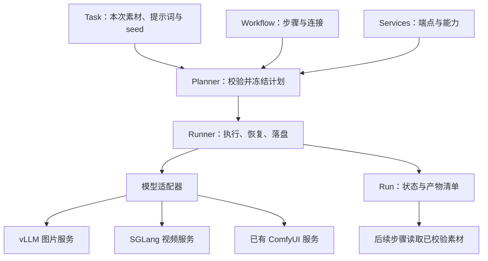

# Workflow / Task 架构设计

日期：2026-11-08。状态：历史设计提案。后续已按讨论收简并实现第一版，当前格式、命令与恢复行为以 [轻量执行器说明](workflow-runner.md) 为准；本文中的多模块划分、配置示例和部分规划未采用。

## 1. 核心决定

保留独立模型部署，在现有 `shared/` 上增加轻量 Python 编排包 `orchestration/`。统一任务生命周期、依赖和产物引用，模型参数与推理协议继续由各模型适配器负责。

第一版采用**本机单执行进程、文件持久化、按 item 顺序执行的静态 DAG**。一个 Task 同一时刻只允许一个执行者；第一版整个执行目录也只允许一个 runner，避免多个任务绕过服务并发限制。无需数据库、消息队列、常驻 API 服务或动态插件系统。



工作流连接的是**服务能力**，不负责启动、下载或部署模型。新增组合通常只需增加 JSON，不需要重新部署 GPU 服务。

## 2. 代码现状与复用边界

以下来自两个本地仓库的实际代码，不假设外部服务具有额外能力。

| 现有实现 | 保留与补齐 |
| --- | --- |
| `shared/http.py` | 保留生成 POST 单次提交、只读 GET 有限重试；将来补结构化错误和鉴权头，便于区分拒绝与提交结果不明 |
| `shared/inference_api.py` | 保留图片同步返回、视频 submit/status/content 两种协议；编排层调用分步接口，不能用隐藏中间 ID 的便利方法代替落盘 |
| `shared/batch.py` | 复用安全 ID、输入摘要、完整性校验；新编排器定义更完整的签名输入 |
| `shared/files.py` | 复用哈希与原子替换；固定 `.tmp` 名只用于锁保护下的串行写入，不宣称支持多写者 |
| 各模型 `app.py` / `model_cache.py` / 下载器 | 保持独立，不将 vLLM、SGLang 依赖装进同一个环境 |
| Pika `workflow_*.json` + `tasks/*.json` | 保留旧入口；这是模型参数预设与批次数据，新增组合 Workflow 时显式导入 |
| ComfyUI `batch_run.py` | 借鉴 DAG、文件引用、任务锁、提交状态落盘；通过 HTTP 接入已有服务，不跨仓库导入整个脚本 |

具体需要修补的现状：

- Pika HTTP 批处理只在下载完成后记录 `video_id`；提交后退出会丢失恢复线索。
- Pika `_request_hash()` 没有包含最终 `seed_start + index`；条目重排会改变实际 seed，却可能保留旧签名。
- SGLang 任务状态可能随服务进程消失。保存 ID 只能尝试找回任务，不能保证服务重启后可恢复。
- ComfyUI 仓库通用 `request()` 默认可重试 POST，但其提交路径另有处理。新适配器必须逐条确认生成请求单次提交，不能直接复制通用重试策略。

## 3. 四个概念与目录

| 概念 | 职责 | 不放什么 |
| --- | --- | --- |
| Service | 逻辑服务 ID、adapter、endpoint 环境变量、部署 revision、能力 | 提示词和批次数据 |
| Workflow | 可复用步骤、参数预设、输入输出端口、步骤依赖 | 真实 endpoint、运行状态 |
| Task | 引用一个 Workflow，提供稳定 item ID、提示词、素材、显式 seed | ComfyUI 节点 ID、执行状态 |
| Run | 一次冻结计划及其执行记录、attempt、产物 | 可修改的业务配置 |

```text
modal-vllm-sglang/
├── 001-moss-image/             # 现有部署与旧入口保留
├── 002-pika-h3-flex/
├── shared/                     # 现有底层工具，无编排反向依赖
├── orchestration/              # 新增；仅 CPU 客户端依赖
│   ├── __main__.py             # python -m orchestration
│   ├── contracts.py            # 数据类型与 schema_version 校验
│   ├── planner.py              # 引用解析、DAG 校验、计划冻结
│   ├── runner.py               # 状态机与调度
│   ├── store.py                # 文件锁、状态原子写入、恢复
│   ├── artifacts.py            # 素材校验、导入与输出 manifest
│   └── adapters/               # 静态注册，无动态导入配置
│       ├── moss.py
│       ├── pika.py
│       └── comfyui.py
├── services.json               # 只含环境变量名，不含凭据
├── workflows/
│   └── custom-moss-pika-fl2va/
│       └── workflow.json
├── tasks/
│   └── 001-story-demo.json
├── inputs/
├── outputs/<task-name>/<run-id>/
│   ├── plan.json               # 冻结配置、revision 和计划哈希
│   ├── state.json              # 唯一状态权威；report 是派生数据
│   ├── report.json
│   ├── inputs/                 # 导入素材快照，不依赖原文件后续变化
│   └── items/<item-id>/<step-id>/attempt-001/
│       ├── request.json        # 可审计请求；不写 token/base64
│       ├── artifacts.json      # 输出名 → 文件/hash/MIME/大小
│       └── image.png 或 video.mp4
└── docs/
```

新任务采用 `NNN-short-description` 命名，文件 stem 与 `name` 一致；历史任务不改名。Workflow 用 `custom-` 表示本项目组合来源，不让模型序号变成业务任务编号。

组合 Workflow 不等同于 ComfyUI API graph。一个 ComfyUI graph 是一个 adapter 的内部资源，节点接线保存在 workflow 目录的专用映射文件里。

## 4. 配置示例

以下是新契约示意，旧 CLI 不支持直接读取。第一版只支持三个引用形式：`item.<字段>`、`steps.<步骤>.<输出>` 和显式文件输入；`ref` 只在专门的输入绑定对象中解释，不在提示词中做字符串替换或执行表达式。

Service 配置：

```json
{
  "schema_version": 1,
  "services": {
    "moss-image": {
      "adapter": "moss",
      "endpoint_env": "MOSS_ENDPOINT",
      "revision": "moss-deployment-r1"
    },
    "pika-video": {
      "adapter": "pika",
      "endpoint_env": "PIKA_ENDPOINT",
      "revision": "pika-deployment-r1"
    }
  }
}
```

revision 是部署者维护的不可变身份，模型权重、代理行为或影响结果的运行参数变化必须更新。不是仅凭 URL 推测版本。凭据使用环境变量或现有 Secret，日志与计划不得存明文 token。

组合 Workflow：MOSS 生成首尾帧，Pika 生成视频。首尾帧由独立提示词生成，只保证数据流正确，不保证角色一致性；需要一致性时可将帧生成步骤换成图像编辑或 ComfyUI 能力。

```json
{
  "schema_version": 1,
  "name": "custom-moss-pika-fl2va",
  "inputs": {
    "first_prompt": "string",
    "last_prompt": "string",
    "motion_prompt": "string",
    "first_seed": "integer",
    "last_seed": "integer",
    "video_seed": "integer"
  },
  "steps": [
    {
      "id": "first",
      "service": "moss-image",
      "operation": "image.generate",
      "params": {"size": "1024x1024", "num_inference_steps": 50},
      "inputs": {
        "prompt": {"ref": "item.first_prompt"},
        "seed": {"ref": "item.first_seed"}
      }
    },
    {
      "id": "last",
      "service": "moss-image",
      "operation": "image.generate",
      "params": {"size": "1024x1024", "num_inference_steps": 50},
      "inputs": {
        "prompt": {"ref": "item.last_prompt"},
        "seed": {"ref": "item.last_seed"}
      }
    },
    {
      "id": "video",
      "service": "pika-video",
      "operation": "video.fl2va",
      "params": {
        "seconds": 5,
        "num_inference_steps": 6,
        "target": {"short_edge": 480, "aspect_ratio": "auto", "duration_seconds": 5.0}
      },
      "inputs": {
        "prompt": {"ref": "item.motion_prompt"},
        "seed": {"ref": "item.video_seed"},
        "first_frame": {"ref": "steps.first.image"},
        "last_frame": {"ref": "steps.last.image"}
      }
    }
  ],
  "outputs": {"video": {"ref": "steps.video.video"}}
}
```

Task 只填业务数据：

```json
{
  "schema_version": 1,
  "name": "001-story-demo",
  "workflow": "workflows/custom-moss-pika-fl2va/workflow.json",
  "items": [
    {
      "id": "shot-001",
      "first_prompt": "清晨，空旷海边，一只红色纸船停在浅水中。",
      "last_prompt": "同一海边，红色纸船漂向远处。",
      "motion_prompt": "纸船随轻柔海浪缓慢漂远，固定机位，海浪环境音。",
      "first_seed": 1001,
      "last_seed": 1002,
      "video_seed": 2101
    }
  ]
}
```

配置路径统一相对仓库根目录；用户素材采用 `{"file": "inputs/example.png"}`。禁止依赖当前工作目录或“找不到就换一个根目录”的隐式回退。外部绝对路径经显式导入后转换为 Run 内素材快照。

每个 item 展开一份 DAG，引用默认只能指向同 item 内的步骤。第一版不支持跨 item 引用、动态循环、条件分支、嵌套 workflow 或任意 Python 表达式。依赖从 `ref` 推导，不再维护第二份 `depends_on`。

## 5. Adapter 的最小契约

固定注册表：`moss`、`pika`、`comfyui`。每个适配器声明 operation、输入类型、命名输出，以及是否能查询远端任务。

```text
prepare(inputs, params) -> PreparedRequest
submit(prepared) -> RemoteJob | ImmediateResult
poll(remote_job) -> queued | running | succeeded | failed | unknown
collect(remote_job_or_result, attempt_dir) -> ArtifactManifest
```

`prepare` 无网络副作用，补齐全部模型默认值并校验约束。Pika 的 6 steps、首尾帧要求与禁止 shift 参数仍在 Pika 适配器；MOSS 的 CFG、尺寸、默认参数仍在 MOSS 适配器。不能靠一个通用 `**kwargs` 吞掉错误参数。

`RemoteJob` 包含服务身份、revision、远端 ID；`ImmediateResult` 用于同步图片。统一的是执行结果契约，不强求同步图片服务拥有可查询的 job ID。

ComfyUI 适配器负责上传输入图片、按显式映射填写节点字段、单次提交 graph、查询 history、下载指定节点的输出。输出节点与槽位必须明确，多个结果不能取“第一个看起来像图片”的文件。非图片上传能力需要单独声明。

第一版只对已部署 HTTP 服务做组合。原有 `modal run` 批处理继续独立使用；后续如需减少冷启动，再增加专门的 Modal 执行方式，不在 runner 内启动 GPU 子进程。

## 6. 稳定性必须落在状态机上

正常流程：`pending → submitting → submitted/running → collecting → succeeded`。

异常状态：`failed` 表示明确失败；`unknown` 表示可能已提交但无法判定；`blocked` 表示依赖未成功。停止本地 runner 仅停止后续调度，不把远端正在执行的任务伪装成已取消。

1. 获得执行目录 OS 文件锁；进程退出自动释放。锁文件存在不代表仍持锁，不自动删除文件抢锁。
2. 离线校验整个 Task：类型、唯一 ID、引用、环、输出端口、模型约束、输入文件。任何条目不合法时不提交整批任务。
3. 冻结 Workflow、Task、适配器版本、服务 revision、素材快照和完整参数；解析 seed 后写入计划。
4. 每次生成前先持久化 `submitting` 与 attempt ID，再发唯一一次生成 POST。
5. 收到远端 ID 立即保存为 `submitted`；之后才轮询。同步返回则进入 `collecting`。
6. 文件写入临时路径，做格式、长度与哈希校验，再原子替换；manifest 落盘后最后标记 `succeeded`。
7. 下游只消费 `succeeded` 且哈希校验通过的命名产物。

| 恢复时发现 | 行为 |
| --- | --- |
| succeeded 且文件、manifest 与签名一致 | 直接复用 |
| submitted/running 且有远端 ID | 查询同一任务，不重新生成 |
| submitting 且没有 ID | 标记 unknown，等待查证或显式新 attempt |
| 远端已完成、下载中断 | 只重试下载 |
| collecting 且本地文件及 manifest 完整 | 验证后完成状态提交 |
| 同步图片响应丢失或落盘前崩溃 | unknown；当前服务缺少查询能力，不能自动恢复结果 |
| 远端 ID 查询不到 / 进程已重启 | unknown；404 不能证明从未计费 |
| 明确的参数拒绝、远端失败 | failed，保存原因；修正配置创建新 Run |
| 上游 failed/unknown | 当前 item 下游 blocked；其他 item 可继续 |

提交和本地落盘之间无法用一个文件事务覆盖远端，因此不承诺 exactly-once。目标是“自动恢复不重复提交，结果不明时停止自动生成”。主动重跑 unknown 必须创建新 attempt 并记录用户操作，保留可能重复计费的事实。

只读 GET 使用有限退避重试；轮询有累计截止时间且单次请求 timeout 不得超过剩余预算。轮询超时是本地观察超时，不等于远端失败。第一版全局串行，每次仅一个生成请求在途；批次结束时存在 failed/unknown/blocked 则非零退出。

## 7. 签名与素材传递

步骤签名包含：schema 版本、适配器版本、service/revision、operation、补全后的最终参数（含实际 seed）、输入素材内容 SHA256、ComfyUI graph 内容与节点映射。不要只哈希文件路径、条目位置或用户填写的局部参数。

计划哈希用于识别整次运行，步骤签名用于验证该步骤产物。第一版只在同一冻结 Run 内恢复，不引入跨 Run 全局缓存。修改 task/workflow 后应创建新 Run；resume 使用原计划，不悄悄套用最新配置。

产物条目至少包含 `name`、`kind`、`mime`、`relative_path`、`sha256`、`bytes`、`producer`。例如 `first.image` 明确表示 first 步骤唯一 image 输出；多输出必须显式命名。

第一版跨服务数据流：源服务下载到本地、完成校验，再由目标适配器上传或转 base64。不能将本机 Windows 路径传给云端服务，也不能假设不同 Modal 服务能访问同一个进程目录。Pika 首尾帧在编码前复用现有的格式和 20 MiB 上限校验。

大文件按流下载，内存读取限于有上限的图像编码。未来对象存储只替换 artifact 的运输方式；R2/HF 归档失败不应触发重新推理，临时签名 URL 也不能作为素材身份或持久引用。

## 8. 渐进落地

### 阶段一：可执行的最小闭环

新增独立 CPU 项目环境与上述编排模块；实现 MOSS 单步、Pika 单步、MOSS 首尾帧 → Pika 三个模板。先完成 plan、run、status、resume；旧脚本与云端部署保持原入口。

拟定 CLI（尚未实现）：

```text
python -m orchestration plan tasks/001-story-demo.json
python -m orchestration run tasks/001-story-demo.json
python -m orchestration status outputs/001-story-demo/<run-id>
python -m orchestration resume outputs/001-story-demo/<run-id>
```

`plan` 完全离线，显示调用次数、依赖与所需服务，不启动 GPU。`run` 在完整校验后创建 Run；`resume` 读取冻结计划，校验当前服务 revision 后恢复。端点迁移需显式更新运行绑定，不能静默更换远端任务所属服务。

### 阶段二：接入已有 ComfyUI 服务

先支持一个已知 API graph 与显式输入输出映射，验证“ComfyUI 图片 → Pika 视频”。graph 与映射复制到组合 workflow 并记录来源、版本，不使用另一仓库的本机绝对路径作为运行依赖。

旧 Task 格式通过显式转换器转为新配置，遇到不支持的语义直接报错。前端后续读取同一 plan/state/report；部署管理与业务任务执行分开，避免两个模块同时维护运行真相。

### 阶段三：按实际瓶颈扩展

只有批量吞吐确实不足时才加入端点级并发与调度；只有需要多机器共同执行时才迁移状态到支持租约的数据库。此时才考虑任务队列。公共包先留在本仓库，第二个消费者需要复用时再抽为版本化包，不用两个仓库互相 sys.path 导入。

## 9. 验收条件

- 离线 fake adapters 验证跨步骤素材连接、类型错误、循环依赖、未知参数与重复 ID。
- 在提交前、提交后但 ID 未写入、ID 写入后、文件写入后、manifest 写入后分别注入中断，验证恢复不会自动重复生成。
- 调整 item 顺序不改变显式 seed；改变 seed、素材内容、模型 revision 必须改变步骤签名。
- 文件损坏不得被复用；未知远端任务不得自动重提；两个 runner 不得同时获得执行锁。
- 网络中断只重试查询/下载；单条失败阻断其下游，其他 item 的运行和退出码符合约定。
- 最后使用实际已部署端点做单条图片、单条视频、跨服务组合验证，确认冷启动、鉴权、任务保留期和素材传输。离线测试不能替代此步骤。

完成标准：用户只需编辑 Task 的业务数据即可运行一个已验证 Workflow；中断后可清楚知道哪些结果可复用、哪些远端任务仍可查询、哪些状态需要人工查证。
